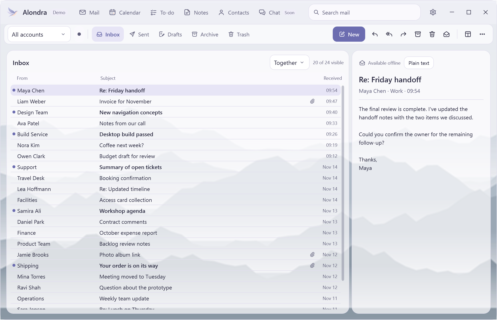
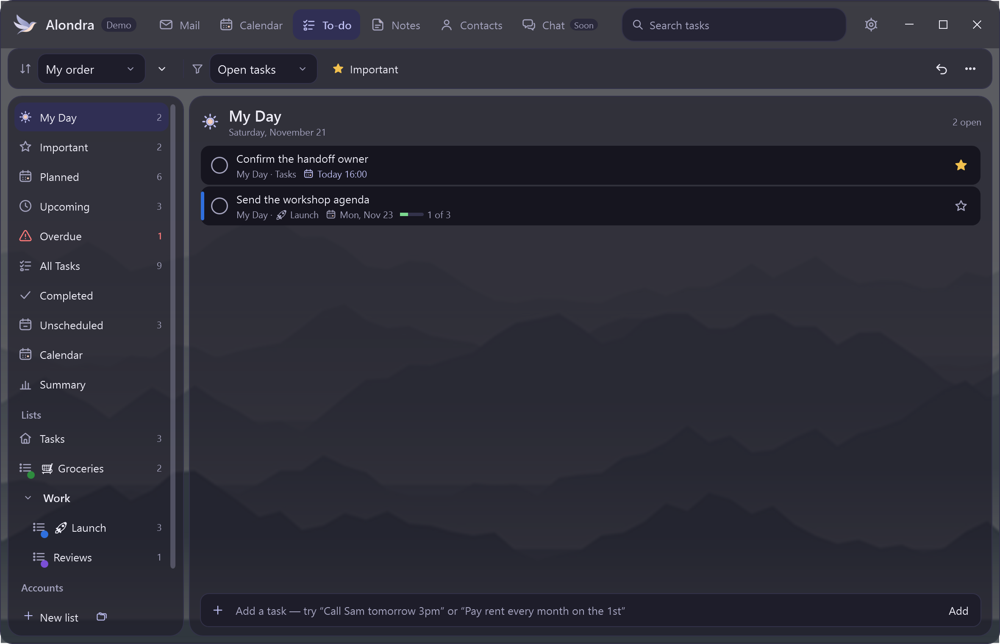

<p align="center">
  
</p>

[](https://github.com/nikita4sea/alondra1-windows/actions/workflows/ci.yml)

**Alondra1** is a calm, lightweight Windows app for your mail, calendar, tasks, notes, and contacts.

- **Local-first.** Your settings, local mail, and tasks live on your PC, and the To-do workspace works with no account or network at all.
- **Private.** Alondra1 has no servers, no telemetry, and no ads. It connects only to the mail accounts you add.

<p align="center">
  
  
</p>

## Highlights

- **Mail:**
  - Microsoft 365, Gmail, and any IMAP, POP3, or SMTP provider.
  - Each account can be *Online* (server only) or *Personal* (full offline copy with search).
  - Safe sending that never duplicates a message.
  - Dockable layout.
- **To-do:** lists and groups, steps, due dates, repeats, reminders, natural-language quick add, smart views, a task calendar, undo, and backup, import, and export. All of it works offline.
- **Calendar, Notes, Contacts:** from your connected Microsoft 365 or Google accounts.
- **Your look:** light and dark themes in the Alondra1 lavender palette, custom colors, and background pictures that are processed on your PC.
- **Simple install:** a per-user setup with no administrator prompt. Updates and uninstalls never touch your data.

See [docs/FEATURES.md](docs/FEATURES.md) for the complete list.

## Install

Download `Alondra1-setup.exe` from [Releases](https://github.com/nikita4sea/alondra1-windows/releases), or build it yourself as shown below. It installs to `%LOCALAPPDATA%\Programs\Alondra1` and adds a Start menu shortcut and an entry in Settings → Apps.

Your data lives in `%LOCALAPPDATA%\alondra1`. Installing a newer version or uninstalling keeps it.

On first launch, choose sample data, import a configuration, or add an account. For Microsoft 365 or Gmail sign-in, register a free public OAuth client first ([docs/OAUTH-SETUP.md](docs/OAUTH-SETUP.md)).

## Build from source

You need the .NET 10 SDK on Windows. For the setup program you also need Inno Setup 6.

```powershell
dotnet build Alondra1.slnx                          # build
dotnet test Alondra1.slnx                           # run the tests
dotnet run --project src/Alondra1.App -- --demo     # try it with sample data
./installer/publish.ps1                             # self-contained build + artifacts/Alondra1-setup.exe
```

Optional test settings (scale test, live mailboxes, fixture updates) are listed in [.env.example](.env.example).

`--demo` uses labeled sample data in a temporary folder and never contacts a provider.

## Documentation

| Document | For |
| --- | --- |
| [Features](docs/FEATURES.md) | Everything Alondra1 does today, by workspace, and the known gaps. |
| [Notes](docs/NOTES.md) | The rich-text Notes module: editor, storage, pictures, sync, limits. |
| [Cloud](docs/CLOUD.md) | Optional Alondra1 account: Cloud Sync for To-do and Mail Archive (paid plans), and how to test against the backend. |
| [Architecture](docs/ARCHITECTURE.md) | Projects, ports and adapters, sync, storage, security, threading. |
| [Code guide](docs/CODE-GUIDE.md) | File-by-file reference, common changes, command-line switches, tests. |
| [Guidelines](docs/GUIDELINES.md) | Principles and rules for code, data, security, UI, testing, and releases. |
| [UI design](docs/UI-DESIGN.md) | Design tokens, palette, icons, responsive behavior, backgrounds. |
| [To-do](docs/TODO.md) | The local task engine in depth: entities, storage, behavior, formats, shortcuts. |
| [OAuth setup](docs/OAUTH-SETUP.md) | Registering Microsoft and Google clients. |
| [Delivery notes](docs/DELIVERY-NOTES.md) | Release history and what was verified. |
| [Reinstall check](docs/runbooks/windows-reinstall-check.md) | The milestone check: uninstall, fresh install, import, sync, snapshot. |
| [Task contract](contract/README.md) | The task JSON Schema and golden fixtures shared with the cloud. |

## Repository layout

| Path | Contents |
| --- | --- |
| `Alondra1.slnx`, `src/`, `tests/` | The app (five projects) and its xUnit tests. |
| `installer/` | Inno Setup script, `publish.ps1`, setup wizard artwork. |
| `design/` | Background picture generator and the mail layout reference. |
| `scripts/` | Reinstall check, reader check, snapshot matrix. |
| `contract/` | Task JSON Schema and fixtures, mirrored in the backend. |
| `docs/` | Documentation, images, and screenshots. |

## CI/CD

| Workflow | When | What |
| --- | --- | --- |
| [`ci`](.github/workflows/ci.yml) | push to `main`, pull requests | Restore, build, and test on `windows-latest` (.NET 10); Markdown link check; gitleaks. |
| [`release`](.github/workflows/release.yml) | tag `vX.Y.Z` | Runs `ci`, checks the tag against `MyAppVersion`, builds the self-contained setup with Inno Setup, and attaches it with a SHA-256 checksum to a draft GitHub release. |

## Related repositories

The optional cloud (Go API, OpenAPI contract, decisions, runbooks) is in [alondra1-backend](https://github.com/nikita4sea/alondra1-backend); the Windows app does not use it yet. Other clients: [alondra1-android](https://github.com/nikita4sea/alondra1-android), [alondra1-iphone](https://github.com/nikita4sea/alondra1-iphone), [alondra1-mac](https://github.com/nikita4sea/alondra1-mac) (not started). Website: [alondra1-www](https://github.com/nikita4sea/alondra1-www).

## Logo


The Alondra1 bird is in [`docs/images`](docs/images):
- transparent PNGs at 64, 512, and 1024 px;
- the README banner.

The app icon is `src/Alondra1.App/Assets/alondra1.ico`. The banner and the setup wizard artwork are generated by `installer/branding/make-branding.ps1`.

## License

[MIT](LICENSE)
