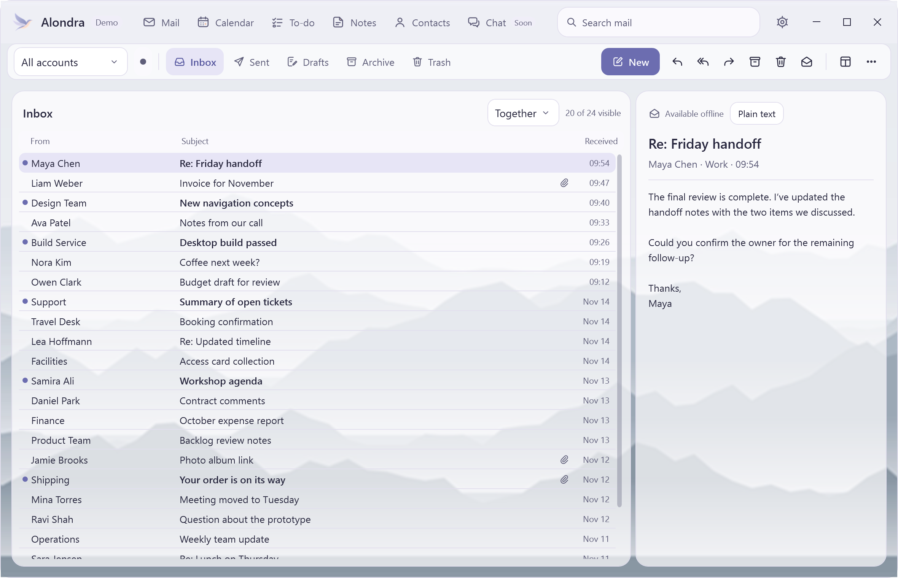
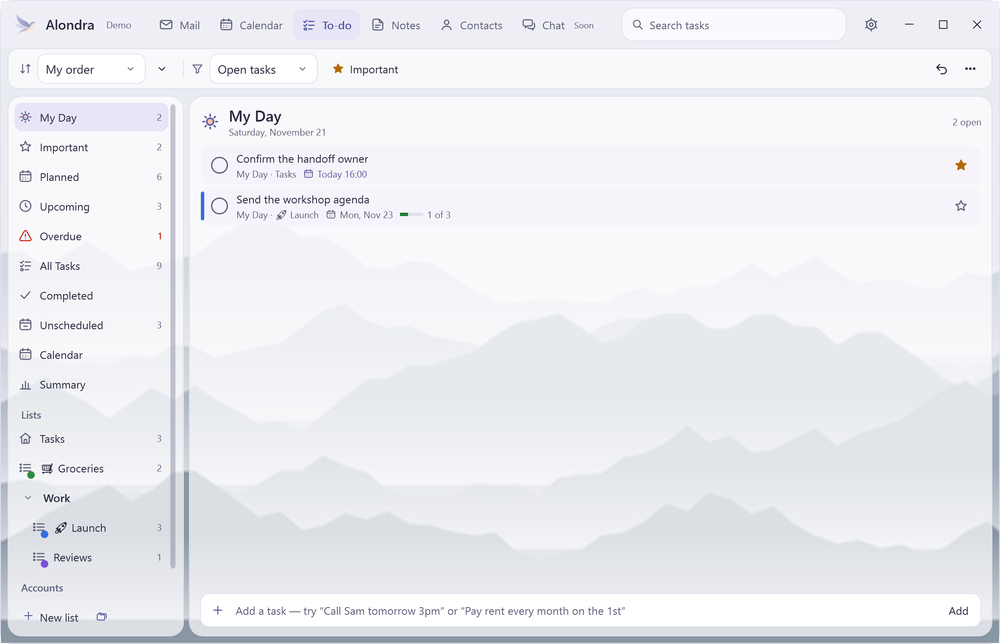
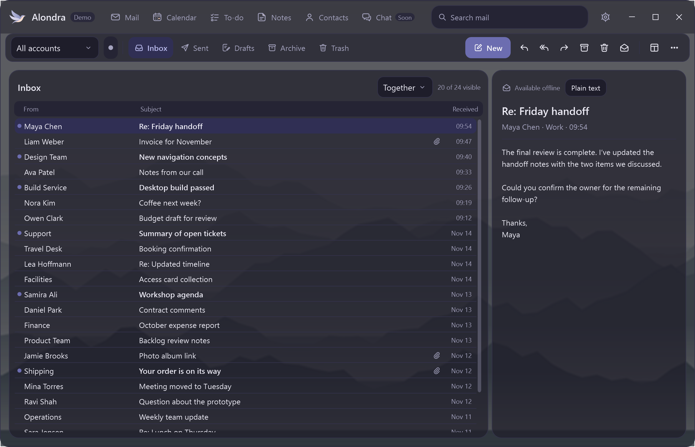
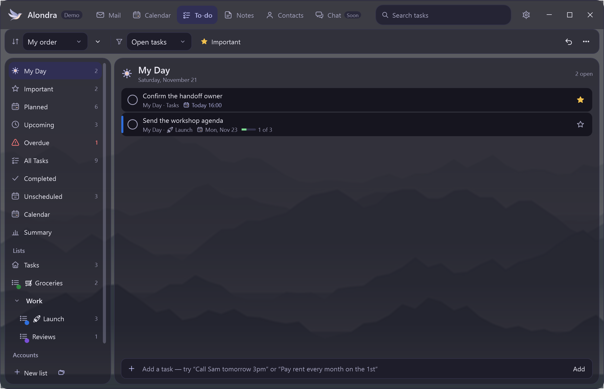
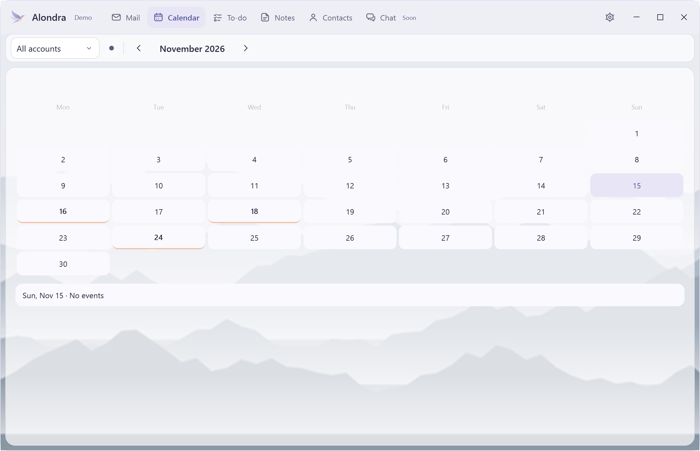
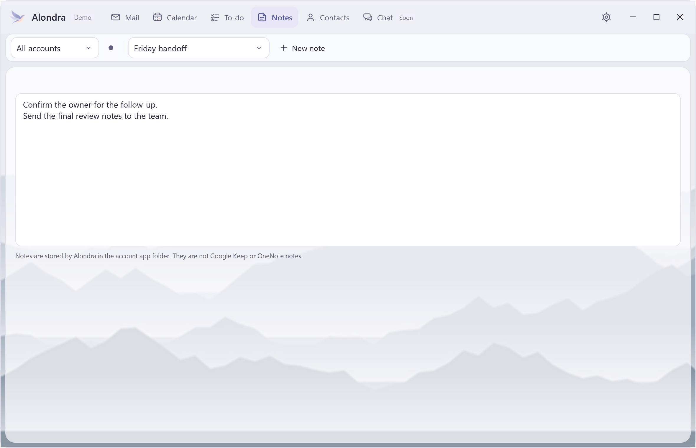
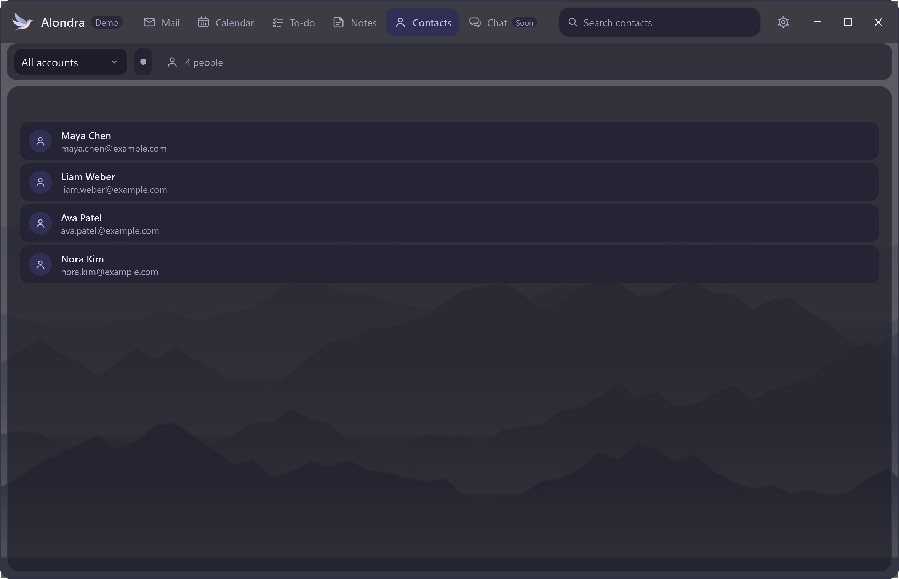
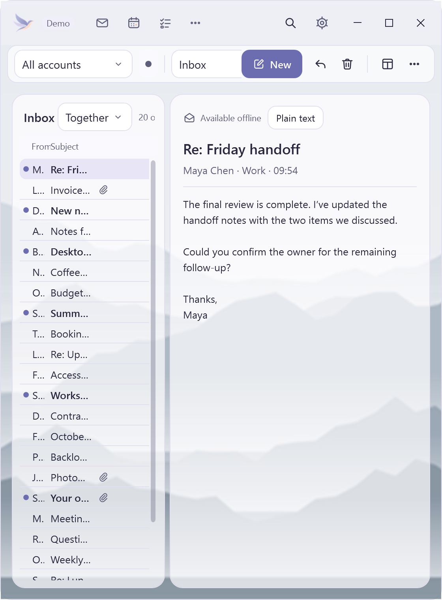

# Features

What Alondra1 does today, by workspace. Each workspace has a keyboard shortcut (Ctrl+1 … Ctrl+6). Items marked *Not yet* are known gaps, not hidden features. [FEATURE-MAP.md](FEATURE-MAP.md) lists every atomic feature with its code, tests and status, for planning new work.

| Mail | To-do |
| --- | --- |
|  |  |
|  |  |

## Mail (Ctrl+1)

**Accounts**

- Microsoft 365 / Exchange Online and Gmail / Google Workspace, with OAuth sign-in. You register your own public client id ([OAUTH-SETUP.md](OAUTH-SETUP.md)).
- Any other provider through manual IMAP or POP3 plus SMTP settings, with password sign-in.
- Presets fill in the documented server names and ports. **Test connection** checks incoming and outgoing mail separately and explains failures, such as IMAP disabled, SMTP AUTH off, or consent missing.
- Two modes per account:
  - **Online:** messages stay on the server and in memory only.
  - **Personal:** a full local copy with offline reading, search, and a durable outbox.
  - Switching between them is safe: queued sends block the switch until they are sent or discarded.
- Encryption: implicit TLS or required STARTTLS. Unencrypted servers are allowed only after an explicit warning and confirmation. OAuth tokens are never sent without encryption.

**Reading**

- An "All accounts" view, grouped *By account* (default) or shown *Together*, or one account at a time; both choices are in Mail's View settings.
- A Sync button (F5) in the toolbar that also shows the connection status: a colored dot, a label on wide windows, and the details of every account in its tooltip.
- Inbox, Sent, Drafts, Archive, and Trash as toolbar tabs (Ctrl+Shift+1 … 5).
- A compact list with unread marks and an attachment indicator, plus a reading pane showing sender, account, and time.
- A message count that always matches the list ("24 messages", "5 of 24 messages" while searching) and an explanation when the list is empty (no search results, offline, sync failed).
- Messages open in their **HTML** version (layout, colors, tables, buttons, pictures) when they have one, with an **HTML | Plain text** switch above the message and a default in Settings → Mail. Plain text is shown with clickable links.
- Pictures inside a message show offline. **Remote images** are blocked until you choose *Load images* or *Always load from this sender* (or set *Always load* in Settings → Mail); obvious tracking pixels stay blocked. Alondra1 has no image proxy, so loading remote images reveals your internet address to the image host.
- HTML is cleaned with an allow-list and shown in an isolated WebView2 with scripts, forms, frames, downloads, and navigation turned off; links open in your browser or mail app.
- Attachments are listed with name, type, and size, with **Open** and **Save**. Files that can run programs ask before opening.
- Search follows the selected account and folder. Personal accounts use a full-text index (tested with 10,000 messages).
- Sync on demand with F5 or More → Sync now. The status dot shows Up to date, Syncing…, Offline, Sync failed, Sample data, or No accounts.
- Switching folders quickly never shows an error page for the previous message.

**Writing**

- New (Ctrl+N), Reply (Ctrl+R), Reply all, and Forward (Ctrl+Shift+F), with From, To, Subject, and Message.
- Save draft.
- Sending with protection against duplicates:
  - Every message keeps a stable Message-ID.
  - A failure before the server accepted the message is retried with backoff.
  - A connection lost after the message was handed over is marked *uncertain* and is not resent automatically.
  - The outbox survives a restart.

**Organizing**

- Archive, Delete (Del), Mark read or unread, for one message or several (Shift/Ctrl to select). Actions apply locally at once and are queued for the server.
- Narrow windows show the list and the message one at a time, with a Back button (Esc).
- Settings → Mail: open messages as HTML or plain text, remote images (ask or always), trusted senders, row density (32 or 40 px), and pane positions.
- POP3 accounts never import the same message twice (UIDL), and they delete from the server only when you turn that on.

**Notes and archive**

- More → **Create note from this email** (or **Create note with its pictures**) makes a note with the subject, sender, date and text, linked back to the message.
- More → **Archive to Alondra1 Cloud** copies the message to your cloud Mail Archive (paid plan, up to 25 MB). Your mailbox is not changed. See [Alondra1 account and cloud](#alondra1-account-and-cloud-optional).

**Layout**

- Folders, list, and reader can each dock to any edge (25 combinations). Splitters are resizable and the sizes are remembered.
- Folders can be shown as toolbar tabs (the default), a side pane, or hidden.
- Compact or Comfortable density.

*Not yet:* attachments in compose, automatic background sync or push (IDLE), move-to-folder, and flags.

## Calendar (Ctrl+2)

- A month grid of events from the Microsoft 365 or Google calendars of the accounts you have connected. Days with events are marked.
- Selecting a day lists its events with their time and account.
- **Meeting notes** next to each event opens the note linked to that event, or starts one: a note titled "‹event› – meeting notes", linked to the event, with the date and time and Agenda, Notes and Action items (a checklist) sections. The Android app uses the same template.
- Previous and next month navigation, and an account selector.
- Local task dates have their own day, week, and month calendar in To-do (below).

*Not yet:* creating or editing events from the window, week or day views for account events, and showing the cloud events created on Android.

## To-do (Ctrl+3)

A complete task manager that works **without any account or network**. Data is stored in `%LOCALAPPDATA%\alondra1\todo.db`. [TODO.md](TODO.md) has the full checklist, file formats, and behavior.

- **Tasks:** title, notes, steps (subtasks) with progress, importance, due date, optional time, start date, My Day, multiple reminders, repeats (daily, weekly on chosen weekdays, monthly, yearly, every N, with an end date), and attached files (copied into the data folder).
- **Lists and groups:** emoji names, eight colors with an optional tint, collapsible groups, drag to reorder or move between groups, duplicate, and delete with undo. The default **Tasks** list cannot be deleted.
- **Smart views:** My Day, Important, Planned, Upcoming, Overdue, All, Completed, Unscheduled. They are filters, so tasks are never duplicated.
- **Quick add** understands natural language offline: "Call Sam tomorrow at 3pm", "Pay rent every month on the 1st", "!" for important. A live preview shows what was understood.
- **Organizing:** sort by my order, due date, importance, created date, or title, with each view remembering its sort. Filter open, all, or completed, or important only. Search across all lists as you type. Bulk select (Shift/Ctrl+click, Ctrl+A) to complete, move, star, add to My Day, or delete.
- **Calendar:** day, week, and month views of task dates, overdue and unscheduled side panels, drag to reschedule (onto an hour to set the time).
- **Reminders:** a reminder bar with Open, Snooze, and Dismiss, plus a Windows notification. They are correct across daylight-saving changes and never shown twice.
- **Summary:** statistics and completion history, including each repeat of a recurring task.
- **Undo:** 50 steps (Ctrl+Z) for every change, including deletions.
- **Data:** export JSON (`alondra1-todo` format), CSV, and iCalendar; import JSON with validation and new ids; back up now; automatic daily backup (7 kept); restore with a safety copy first; print the current view (Ctrl+P).
- **Account tasks:** Microsoft To Do and Google Tasks from connected accounts, in their own sidebar section.

*Not yet:* reminders while Alondra1 is closed, iCalendar import, and dragging steps to reorder them (they have up and down buttons).

## Notes (Ctrl+4)

Local rich-text notes, stored in todo.db on this PC. No account or connection is needed. Details: [NOTES.md](NOTES.md).

- **Layout.** Three panes:
  - left: All notes, Favorites, your folders (nested, with counts), Archive and Trash;
  - middle: the note list, with previews, dates, favorite and pin marks, and picture thumbnails;
  - right: the editor.

  The lists can be hidden to focus on the note; below 900 px the panes show one at a time.
- **Editor formatting:**
  - bold, italic, underline, strikethrough, inline code;
  - fonts (Segoe UI, Arial, Calibri, Georgia, monospace) and sizes from 8 to 72 pt;
  - text color (palette or any hex) and highlight;
  - headings 1–3, alignment, indent, paragraph spacing;
  - links, quote, code block, divider;
  - undo/redo, clear formatting, find in note (Ctrl+F).
- **Lists:** bulleted, numbered and checklists, nested with Tab and Shift+Tab. A checklist item can become a To-do task, and the item then links to the task.
- **Tables:**
  - insert with a size grid;
  - add or remove rows and columns;
  - header row, cell colors, column resizing;
  - multi-cell selection and copy and paste.
- **Pictures:**
  - add with the picker, drag and drop or paste;
  - resize keeping the aspect ratio, align, add a caption;
  - stored once, by content hash.

  Pictures in pasted web content are not downloaded until you click **Load picture**.
- **Organizing:**
  - create, rename (the title), duplicate, move (menu or drag onto a folder), favorite, pin, archive;
  - Trash, kept for 30 days, with restore and permanent delete;
  - sort by last edited, date created or title;
  - multi-select;
  - full-text search across titles and text (the header search box).
- **Links to other items:** link a note to a task, a calendar event or a contact (**Link**), or create a note from an email (Mail → More → **Create note from this email**, optionally with its pictures). Linked items open from the chips above the note; a deleted item is reported as unavailable.
- **Import and export:**
  - export as a self-contained HTML file or as Markdown with a picture folder;
  - import an HTML file as a new note;
  - import the plain-text notes that earlier versions kept in mail accounts.
- **Saving:** automatic, a moment after you stop typing, and immediately when you switch notes, leave Notes, close the app or press Ctrl+S.
- **Cloud Sync:** with Cloud Sync on, notes, folders and pictures sync with the Android app and other PCs.
- **Sync conflicts:** if the same note changed on two devices before they synced, both versions are kept. A banner above the note (or **Compare** in Settings → Cloud → Sync issues) shows both side by side with the differing lines marked. You can keep the other device's version, keep this PC's version, **Combine both** into the note and tidy it up by hand, or keep both as separate notes.

*Not yet:* merged table cells, text wrapping around pictures, dragging folders into folders, a floating formatting bar, and automatic merging of edits inside the same paragraph.

## Alondra1 account and cloud (optional)

Alondra1 works fully without an account. **Settings → Cloud** adds, after signing in with a 6-digit code sent by email:

- **Plan and devices:** your plan and its state (active, ending, read-only), the signed-in devices, and **Manage account online**. Payment is not available yet; plans are granted on the server.
- **Cloud Sync** (paid plans): tasks, lists, groups, notes, note folders and note pictures, shared with the Android app and other PCs. Turning it on first backs up your data and merges, so nothing is replaced or deleted. It runs every few minutes, soon after a change, and on **Sync now**; **Pause** stops it. A status button appears in the To-do toolbar. Conflicts keep both versions and are listed under **Sync issues**.
- **Mail Archive** (paid plans): copies of messages you choose, with search.

When a plan ends, nothing on the PC is deleted; new changes stay on the PC until you renew. Details: [CLOUD.md](CLOUD.md).

## Contacts (Ctrl+5)

- Contacts from Microsoft 365 or Google People, with search by name or e-mail.

*Not yet:* editing contacts from the window.

## Chat (Ctrl+6)

Shown as **Soon**. There is no chat feature yet.

## Appearance and personalization

- Light, Dark, or follow Windows. Dialog title bars follow the theme too.
- Palette derived from the Alondra1 logo. Every color can be overridden per theme (Settings → Appearance → Edit light / dark colors) and reset.
- **Background pictures:** seven built-in originals, or your own PNG, JPEG, or WebP. It is copied and processed locally, with opacity, blur, desaturation, brightness, overlay, position, and fit, and a live preview. Brightness adapts to the theme so text stays readable.
- 62 custom Alondra1 icons.
- Responsive layout: as the window narrows, labels turn into icons and items move into More menus. It works down to about 470 px.

## Settings, data, and privacy

- **Settings pages:**
  - Appearance (theme, colors);
  - Background (picture and adjustments);
  - Accounts (add, edit, switch mode, delete). Deleting an account removes its settings, saved password and sign-in, local mail copy, attachment files, and outbox from this PC after a confirmation. Mail on the server is not changed;
  - Connections (OAuth client ids, and which organizer features to enable: Calendar, To-do, Contacts, Notes);
  - Data (import or export the configuration, storage use, remove unpinned attachment files);
  - Cloud (Alondra1 account, plan, Cloud Sync, sync issues, Mail Archive, devices).
- **Configuration import** shows a preview and lets you **Merge** or **Replace after review**. Exports contain public client ids but never passwords or tokens.
- **Secrets** are stored with Windows DPAPI for your user account only.
- **First launch** offers sample data, importing a configuration, or adding an account.
- **Demo mode** (`--demo`) uses clearly labeled sample data in a temporary folder.
- **No telemetry or ads.** Network access goes only to the mail and organizer accounts you add and, if you sign in to an Alondra1 account, to the Alondra1 cloud.

## Installation

- `Alondra1-setup.exe` is a per-user installer with no administrator prompt. It has a branded wizard, a Start menu shortcut, an optional desktop shortcut, and an entry in Settings → Apps.
- Installing a newer version upgrades in place. Uninstalling removes the program but keeps `%LOCALAPPDATA%\alondra1` (your settings, mail, and tasks).
- The app is self-contained: no .NET installation is needed. It runs on 64-bit Windows 10 and 11.
